# ThreadGrid — AI Cyber Defense Platform
### A Security Operations Center (SOC) with Intelligent Threat Detection & Automated Response

[](https://www.python.org/)
[](https://fastapi.tiangolo.com)
[](https://react.dev/)
[](https://www.typescriptlang.org/)
[](https://vitejs.dev/)
[](https://www.sqlite.org/wal.html)
[](tests/)
[](LICENSE)

---

## 1. Executive Overview & Research Hypothesis

**ThreadGrid** is an academic research prototype and lightweight, locally deployable Security Information and Event Management (SIEM) and Security Operations Center (SOC) platform inspired by enterprise systems like Splunk. It provides an end-to-end security operations pipeline spanning native operating system log collection, canonical schema normalization, authenticated high-throughput ingestion, deterministic threat detection, machine learning behavioral anomaly detection, alert deduplication, multi-entity incident correlation, evidence-grounded AI copilot investigation, and approval-gated automated containment.

### Central Research Hypothesis
> *"Combining explainable anomaly detection, deterministic rule-based correlation, sliding-window alert deduplication, and evidence-grounded AI assistance significantly reduces security analyst investigation time and alert fatigue (by 85–90%) without degrading threat detection recall or introducing hallucination and command-injection vulnerabilities into automated response workflows."*

---

## 2. System Architecture & High-Level Flowcharts

The end-to-end platform is structured into modular, independently testable stages:

```mermaid
flowchart TD
    subgraph Log_Sources["1. Log Sources & Collection Layer"]
        L1["Kali Linux / Debian<br/>(/var/log/auth.log or journald)"]
        L2["Windows Server<br/>(Security Event Log 4624, 4625, 4672)"]
        C1["LinuxAuthCollector<br/>(Durable Inode & Byte Checkpoints)"]
        C2["WindowsSecurityCollector<br/>(Native EvtQuery / EvtRender Bookmarking)"]
        L1 --> C1
        L2 --> C2
    end

    subgraph Ingestion_Layer["2. Normalization & Ingestion API"]
        NORM["Canonical Normalization Engine<br/>(Schema v1.0, UTC ISO-8601, SHA-256 Fingerprints)"]
        SHIP["HttpEventShipper<br/>(Authenticated Batch Shipping)"]
        API["FastAPI Central Ingestion Service<br/>(API Key / Bearer Auth, Rate Limiter, Body Limit)"]
        SINK["EventStorageSink & SQLite DB<br/>(WAL Mode, Parameterized Queries, Dedicated Indexes)"]

        C1 --> NORM
        C2 --> NORM
        NORM --> SHIP
        SHIP -->|"POST /api/v1/events/batch"| API
        API --> SINK
    end

    subgraph Detection_ML_Layer["3. Detection & Machine Learning Engines"]
        RULE["Deterministic Threat Detection<br/>(RULE-001 Brute Force, RULE-002 Breach Success,<br/>RULE-003 Spray, RULE-004 Priv, RULE-005 Recon)"]
        ML["Unsupervised ML Anomaly Detection<br/>(Isolation Forest, 10 Behavioral Features,<br/>Explainable Z-Score Attribution)"]

        SINK --> RULE
        SINK --> ML
    end

    subgraph Correlation_Layer["4. Alert Deduplication & Incident Correlation"]
        DEDUP["Sliding-Window Alert Deduplicator<br/>(Fingerprint Hashing, Occurrence Counter, 85-90% Reduction)"]
        CORR["Entity-Temporal Graph Correlator<br/>(Connected Components across Source IP / Usernames)"]
        RISK["Deterministic Risk Engine<br/>(Base Severity, Rule Diversity, Kill-Chain Progression)"]
        INC_REPO["IncidentRepository & Forensic Timeline<br/>(Chronological Milestones, Analyst Notes, State Machine)"]

        RULE --> DEDUP
        ML --> DEDUP
        DEDUP --> CORR
        CORR --> RISK
        RISK --> INC_REPO
    end

    subgraph Presentation_Layer["5. SOC Analyst Console & AI Copilot"]
        UI["React 18 + TypeScript SOC Dashboard<br/>(Real-Time Overview, Live Events, Alerts Queue, Incident Triage)"]
        AI["Evidence-Grounded AI Copilot<br/>(Active Prompt Defense, 100% Strict Citation Validation,<br/>MITRE ATT&CK Mapping, Zero-Hallucination)"]

        INC_REPO --> UI
        INC_REPO --> AI
        AI <--> UI
    end

    subgraph Response_Layer["6. Controlled Automated Response Engine"]
        RESP_ENG["ResponseEngine & PolicyEngine<br/>(Dry-Run Default, Reversible Handlers)"]
        SAFETY["SafetyGuard<br/>(Allowlist Verification: Gateways, DNS, Localhost, Root/Admin;<br/>Command Injection Defense)"]
        HUMAN{"Human-in-the-Loop Gate<br/>(Analyst Sign-Off Required for Disruptive Actions)"}
        EXEC["Modular Action Handlers<br/>(Block IP, Lock User, Terminate Session, Notify Analyst)"]
        AUDIT[("Append-Only JSONL Audit Trail<br/>& Complete Rollback Support")]

        AI -->|"Stage Recommendations"| RESP_ENG
        UI -->|"Manual Proposal / Approval"| RESP_ENG
        RESP_ENG --> SAFETY
        SAFETY --> HUMAN
        HUMAN -->|"Approved"| EXEC
        HUMAN -->|"Rejected"| AUDIT
        EXEC --> AUDIT
    end
```



---

## 3. Threat Detection & Correlation Workflow

```mermaid
sequenceDiagram
    autonumber
    actor Attacker as Threat Actor
    participant Kali as Kali / Linux Host
    participant Coll as LinuxAuthCollector
    participant API as Ingestion API (FastAPI)
    participant DB as SQLite Storage (WAL)
    participant Engine as Detection & ML Engine
    participant Correlator as Incident Correlator
    participant SOC as SOC Analyst Console
    participant AI as AI Copilot
    participant Resp as Response Engine

    Attacker->>Kali: 5x Failed SSH logins + 1x Accepted SSH login
    Kali->>/var/log/auth.log: Appends raw auth entries
    Coll->>/var/log/auth.log: Incrementally tails file from last offset checkpoint
    Coll->>Coll: Normalizes into SecurityEvent Schema v1.0
    Coll->>API: POST /api/v1/events/batch (Authenticated with X-API-Key)
    API->>DB: Stores events & calculates deduplication hash
    Engine->>DB: Evaluates sliding windows across events
    Engine-->>Engine: Fires RULE-001 (Brute Force) & RULE-002 (Failed Then Success)
    Engine->>Correlator: Emits raw alerts with entity bindings (IP: 198.51.100.42, User: admin)
    Correlator->>Correlator: Deduplicates alerts & clusters via connected components graph
    Correlator->>DB: Persists Incident (Status: NEW, Risk Score: 85.0) with Chronological Timeline
    SOC->>API: Polls live incidents, alerts, and system health
    API-->>SOC: Renders real-time incident queue and KPI metrics
    SOC->>AI: Requests Investigation Report for Incident
    AI->>AI: Sanitizes untrusted log text via PromptInjectionSanitizer
    AI->>AI: Verifies citations strictly against ground-truth incident events
    AI-->>SOC: Returns Verified Facts, MITRE Hypotheses, and Actionable Containment Steps
    SOC->>Resp: Approves Containment Action (Block IP: 198.51.100.42)
    Resp->>Resp: SafetyGuard checks allowlist & injection characters
    Resp->>Resp: Executes action (or simulates in dry-run mode)
    Resp->>/output/response_audit.jsonl: Appends non-repudiation audit record
    SOC->>Resp: Can trigger instant Rollback at any time
```

---

## 4. Key Functional Modules & Implementation Details

### 1. Custom Log Collection (`collectors/`)
- **Linux Collector (`collectors/linux/`)**:
  - Tails `/var/log/auth.log` (Debian/Ubuntu/Kali) or queries `systemd-journald` via cursor streaming.
  - Maintains durable atomic checkpoints (`checkpoint_linux.json`) tracking `(inode, file_offset, file_size)`.
  - Safely handles log rotation, log truncation, and process restarts without rereading whole files or skipping records.
  - Parsers extract SSH password/publickey successes, failures, invalid users, and sudo command execution.
- **Windows Server Collector (`collectors/windows/`)**:
  - Interfaces with native Windows Event Log API (`win32evtlog.EvtQuery`, `EvtNext`, `EvtRender`).
  - Supports Security Event IDs **4624** (Logon), **4625** (Failed Logon), and **4672** (Special Privileges).
  - Maintains `EventRecordID` bookmarking (`checkpoint_windows.json`) and detects event log resets.
  - Isolates Windows-specific imports so Linux/macOS testing never raises import errors.

### 2. Canonical Normalization & Schema v1.0 (`collectors/common/`)
- Versioned Pydantic `SecurityEvent` model:
  - `schema_version`: Strict `"1.0"`
  - `event_id`: Deterministic fingerprint `evt_<sha256>` computed from `(source_host, source_type, timestamp, raw_event)`
  - `timestamp` & `observed_at`: Strict UTC ISO-8601 formatting (`YYYY-MM-DDTHH:MM:SSZ`)
  - `source_host`, `source_type`, `event_type`, `username`, `source_ip`, `destination_ip`, `windows_event_id`, `severity`
  - `raw_event`: Preserves unmanipulated raw syslog or Windows XML text for forensic fidelity.
  - Missing data is stored strictly as `null` (never fabricated or guessed).

### 3. Central Ingestion Service (`backend/api/`)
- High-throughput FastAPI application factory.
- Authenticated via API key (`X-API-Key`) or Bearer token (`Authorization: Bearer <key>`).
- Sliding-window thread-safe rate limiter per Client IP / Agent ID with HTTP 429 and `Retry-After` calculation.
- Request payload size enforcement middleware (HTTP 413) protecting against memory exhaustion.
- Structured JSON access logging recording request duration, status code, client IP, and Agent ID.

### 4. Storage & Indexed Search Query Engine (`backend/storage/`)
- Decoupled `EventRepository` interface guaranteeing backend modularity.
- `SQLiteEventRepository` operating with **WAL (Write-Ahead Logging) mode** (`PRAGMA journal_mode=WAL; PRAGMA synchronous=NORMAL;`).
- Explicit database indexes on `timestamp`, `source_host`, `username`, `source_ip`, `event_type`, and `severity`.
- Multi-field parameterized search filters, pagination offset/limits, and hourly/minutely time-series bucketing.

### 5. Deterministic Threat Detection Engine (`backend/detection/`)
Five deterministic rules with configurable sliding time windows and thresholds:
| Rule ID | Rule Name | MITRE ATT&CK | Description |
| :---: | :--- | :---: | :--- |
| **`RULE-001`** | **Single Source Brute Force** | T1110.001 | Detects $\ge 5$ authentication failures from a single IP within 300 seconds. |
| **`RULE-002`** | **Failed Followed by Success** | T1110 / T1078 | Detects $\ge 3$ authentication failures followed by a successful login for the same user within 600 seconds (compromise indicator). |
| **`RULE-003`** | **Distributed Password Spray** | T1110.003 | Detects $\ge 3$ distinct source IPs failing authentication against the same user within 600 seconds. |
| **`RULE-004`** | **Privileged Activity Indicator** | T1068 / T1548 | Flags sensitive sudo command execution (`/etc/shadow`, `visudo`, `/bin/bash`) or remote Windows Event 4672 logons. |
| **`RULE-005`** | **Suspicious Authentication Sequence** | T1087 / T1110 | Detects invalid username reconnaissance followed by targeted authentication attempts. |

### 6. Alert Deduplication & Incident Correlation (`backend/correlation/`)
- **Sliding-Window Deduplication**: Groups repeated alert occurrences with identical fingerprints (`fp_<hash>`) over a sliding 900-second window, collapsing hundreds of noisy alerts into single aggregates with updated counts and merged evidence.
- **Entity-Temporal Graph Correlation**: Links alerts into coherent multi-stage incidents using connected components clustering across shared valid security entities (`source_ip`, `username`) within a 3600-second window.
- **False Correlation Invariants**: Explicitly filters out generic placeholders (`unknown`, `system`, empty strings) and segregates host-only correlations to avoid merging unrelated events on multi-tenant servers.
- **Explainable Risk Scoring**: Deterministic formula ($0–100$) combining base severity, rule diversity bonus, kill-chain progression bonus, volume factor, and target scope.

### 7. Unsupervised Machine Learning Anomaly Detection (`backend/ml/`)
- **Isolation Forest Baseline**: `sklearn.ensemble.IsolationForest` (`n_estimators=100`, `contamination=0.05`, `random_state=42`).
- **10 Behavioral Features**: Extracted over entity sliding windows: `event_count`, `failure_count`, `success_count`, `failure_ratio`, `unique_usernames_targeted`, `username_entropy`, `unique_hosts_targeted`, `auth_velocity_per_min`, `mean_inter_arrival_time`, `inter_arrival_variance`.
- **Explainable Feature Attribution**: Computes empirical z-score deviations against baseline normal distributions to tell analysts in plain English which features drove the anomaly score.
- **Comparative Academic Benchmark**: Catches stealthy "slow-and-low" attacks (e.g. 1 failure every 2 minutes) that deliberate evade fixed static thresholds, achieving 100% recall where static rules achieve 0% recall.

### 8. Evidence-Grounded AI Investigation Assistant (`backend/ai/`)
- **Active Prompt-Injection Defense (`PromptInjectionSanitizer`)**: Defends against adversarial strings embedded inside raw logs attempting to hijack triage judgments; strips override phrases and encapsulates logs inside `<untrusted_evidence_log>` boundaries.
- **Strict Programmatic Citation Validation (`CitationValidator`)**: Every cited event ID or alert ID within the AI report must strictly exist in the incident evidence; guarantees **0% hallucination**.
- **Structured Investigation Reports**: Generates Verified Facts (cited), Threat Hypotheses (MITRE ATT&CK techniques with confidence scores), and Prioritized Actionable Recommendations.
- **Local & Offline**: Defaults to `offline-evidence-synthesizer-v1` with zero paid cloud API dependencies.

### 9. Controlled Automated Response Engine (`backend/response/`)
- **Safe Defaults**: `dry_run = True` by default across all actions.
- **Non-Negotiable Allowlists (`SafetyGuard`)**: Rejects containment proposals targeting localhost (`127.0.0.1`, `::1`), default gateways (`192.168.1.1`, `10.0.0.1`), DNS servers, and administrative accounts (`root`, `administrator`, `system`).
- **Command Injection Defense**: Rejects inputs with shell metacontrol characters (`;`, `&`, `|`, `` ` ``, `$`).
- **Human-in-the-Loop Gating (`PolicyEngine`)**: Disruptive actions (`block_ip`, `lock_account`, `terminate_session`) require explicit SOC analyst sign-off.
- **Complete Reversible Rollback**: Handlers support instantaneous state restoration (`ROLLED_BACK`).
- **Non-Repudiation Audit Log**: Append-only log maintained at `output/response_audit.jsonl`.

### 10. Modern SOC Analyst Frontend (`frontend/`)
- Built with React 18, Vite, TypeScript, and Lucide React.
- High-density dark enterprise SOC visual language.
- Real API bindings throughout:
  - **Overview**: Real-time KPI statistics, dynamic event timelines, severity distributions, and active incidents.
  - **Alerts Queue**: Severity filtering and full forensic evidence inspector.
  - **Incidents Queue**: Lifecycle status controls (`NEW` $\rightarrow$ `INVESTIGATING` $\rightarrow$ `RESOLVED` $\rightarrow$ `CLOSED`), risk meters, and analyst note collaboration.
  - **Event Explorer**: Multi-field full-text search, column sorting, pagination, and raw log inspection.
  - **AI Copilot Panel**: Interactive citation chips, MITRE technique tags, and 1-click containment staging.
  - **Response Console**: Real-time safety status indicators, dry-run toggles, approval sign-off modals, and rollback triggers.

---

## 5. Repository Directory Structure

```text
├── backend/
│   ├── ai/                      # Evidence-grounded AI copilot & prompt defense
│   │   ├── citation_validator.py
│   │   ├── copilot.py
│   │   ├── prompt_defense.py
│   │   └── schemas.py
│   ├── api/                     # FastAPI ingestion service & REST endpoints
│   │   ├── middleware.py        # Request size limits & structured JSON logging
│   │   ├── rate_limiter.py      # Sliding-window rate limiter
│   │   ├── routes/              # Modular API routers (events, alerts, incidents, etc.)
│   │   └── storage_sink.py      # SQLite persistent storage sink
│   ├── correlation/             # Alert deduplication, graph clustering & incidents
│   │   ├── correlator.py        # Connected components entity-temporal clustering
│   │   ├── deduplicator.py      # Sliding-window fingerprint deduplication
│   │   ├── repository.py        # SQLite incident repository & lifecycle state machine
│   │   └── risk.py              # Deterministic risk prioritization formula
│   ├── detection/               # Deterministic rule-based threat detection
│   │   ├── engine.py            # Rule orchestrator
│   │   └── rules/               # RULE-001 through RULE-005 implementations
│   ├── ml/                      # Unsupervised ML behavioral anomaly detection
│   │   ├── alert_generator.py   # Canonical alert mapper
│   │   ├── evaluation.py        # Leakage-free train/test evaluation harness
│   │   ├── explainability.py    # Empirical z-score feature attribution
│   │   ├── features.py          # 10 quantitative temporal feature extractors
│   │   └── model.py             # Isolation Forest model wrapper
│   ├── response/                # Controlled automated response engine
│   │   ├── engine.py            # Orchestrator & staging pipeline
│   │   ├── handlers/            # Block IP, Lock Account, Terminate Session, Notify
│   │   ├── policy.py            # Human-in-the-loop approval gating
│   │   ├── repository.py        # SQLite state & append-only audit logger
│   │   └── safety.py            # Target allowlists & command injection defense
│   └── storage/                 # Abstract repository interface & SQLite implementation
│       ├── base.py              # Abstract EventRepository interface
│       ├── models.py            # Filter, pagination, and bucket models
│       └── sqlite_repository.py # WAL mode indexed storage engine
├── collectors/
│   ├── common/                  # Shared schemas, normalization & HTTP shipper
│   ├── linux/                   # Kali / Debian auth.log & journald collector
│   └── windows/                 # Windows Event Log API native collector
├── config/                      # Configuration files for collectors and services
├── docs/                        # Research evaluation, threat model, setup, and test docs
├── frontend/                    # Modern React 18 + TypeScript SOC Analyst Console
│   ├── src/
│   │   ├── components/          # Reusable SOC components (AICopilot, EventExplorer, etc.)
│   │   ├── pages/               # Routed pages (Overview, Alerts, Incidents, System, etc.)
│   │   ├── services/            # Typed API client
│   │   └── types/               # TypeScript interfaces
├── requirements.txt             # Constrained Python dependencies
├── scripts/                     # Traffic and attack simulation scripts
└── tests/                       # 149 comprehensive unit and integration tests
    ├── fixtures/                # Synthetic Linux auth logs & Windows XML samples
    ├── integration/             # End-to-end Kali collection to correlation pipeline tests
    └── unit/                    # Unit test suites across all modules
```

---

## 6. Installation & Setup Guide

### Prerequisites
- **Operating System**: Windows 10/11 or Linux (Ubuntu, Debian, Kali)
- **Python**: 3.10+ (tested on Python 3.13)
- **Node.js**: 18+ (tested on Node.js v22) & npm

---

### Step 1: Clone the Repository
```bash
git clone https://github.com/harshpjain77-design/majpro.git
cd majpro
```

---

### Step 2: Set Up Backend Virtual Environment
```powershell
# Windows (PowerShell)
python -m venv .venv
.\.venv\Scripts\Activate.ps1
pip install -r requirements.txt
```
```bash
# Linux / macOS
python3 -m venv .venv
source .venv/bin/activate
pip install -r requirements.txt
```

---

### Step 3: Run the FastAPI Backend
```powershell
# Windows
.\.venv\Scripts\python.exe -m uvicorn backend.api.main:app --host 127.0.0.1 --port 8000
```
```bash
# Linux
python3 -m uvicorn backend.api.main:app --host 127.0.0.1 --port 8000
```
- **Backend API & Swagger Docs:** [http://127.0.0.1:8000/docs](http://127.0.0.1:8000/docs)
- **Health Check:** [http://127.0.0.1:8000/api/v1/system/health](http://127.0.0.1:8000/api/v1/system/health)

---

### Step 4: Set Up and Run the Frontend
In a new terminal window:
```bash
cd frontend
npm install
npm run dev
```
- **Frontend Dashboard:** [http://localhost:3000](http://localhost:3000)
- Vite automatically proxies API requests (`/api/*`) to `http://127.0.0.1:8000`.

---

### Step 5: (Optional) Run Native Collectors
- **Linux Collector (Kali / Ubuntu)**:
  ```bash
  python3 -m collectors.linux.collector --config config/collector.linux.json
  ```
- **Windows Server Collector**:
  ```cmd
  python -m collectors.windows.collector --config config\collector.windows.json
  ```

---

## 7. Simulating Live Traffic & Verification

To verify the platform end-to-end without needing external VMs, run the included attack and telemetry simulator:

```powershell
# Generate realistic benign and multi-stage attack traffic
.\.venv\Scripts\python.exe scripts/simulate_live_traffic.py --target http://127.0.0.1:8000 --batch-size 25
```

This simulates:
1. Normal user authentications across distributed workstations.
2. Brute-force password guessing from a single malicious source IP (`RULE-001`).
3. Brute force followed by successful unauthorized logon (`RULE-002`).
4. Multi-host password spraying against an administrative account (`RULE-003`).
5. Unauthorized sudo execution of sensitive shadow files (`RULE-004`).
6. Invalid user enumeration sequence (`RULE-005`).

---

## 8. Running Automated Test Suite

The platform includes **149 automated tests** covering unit behavior, regression edge cases, positive/negative rule firing, ML training leakage prevention, prompt injection defanging, and end-to-end integration:

```powershell
# Run the complete test suite
pytest tests/ -v
```

```powershell
# Run the Kali collector end-to-end integration test
pytest tests/integration/test_e2e_kali_pipeline.py -v
```

**Test Coverage Summary:**
- 100% of detection rules validated against positive and negative test cases.
- Invariant tests verifying zero false correlations across disjoint entities or expired windows.
- Invariant tests verifying that prompt injection attempts inside raw logs are defanged.
- Invariant tests verifying that 100% of AI copilot citations point to ground-truth event IDs.
- Invariant tests verifying that protected allowlist entities (localhost, gateway, root) cannot be blocked.

---

## 9. REST API Reference

| Method | Endpoint | Description |
| :---: | :--- | :--- |
| `GET` | `/api/v1/system/health` | Service health status, database connectivity, and stored event count |
| `POST` | `/api/v1/events/batch` | Ingest a batch of normalized security events with API key authentication |
| `GET` | `/api/v1/events` | Multi-field search and filtered query on stored events |
| `GET` | `/api/v1/events/{id}/raw` | Retrieve unmanipulated raw syslog or Windows XML evidence |
| `GET` | `/api/v1/events/summary/counts` | Aggregated counts by severity, event type, and active hosts |
| `GET` | `/api/v1/alerts` | Query active alerts evaluated by the detection engine |
| `GET` | `/api/v1/detection/rules` | List all 5 registered deterministic detection rules and metadata |
| `GET` | `/api/v1/incidents` | List paginated incidents ordered by risk score descending |
| `GET` | `/api/v1/incidents/{id}` | Full incident details with chronological timeline and analyst notes |
| `PATCH` | `/api/v1/incidents/{id}/status` | Transition incident lifecycle status (`NEW` $\rightarrow$ `INVESTIGATING` $\rightarrow$ `RESOLVED` $\rightarrow$ `CLOSED`) |
| `POST` | `/api/v1/incidents/correlate` | Manually trigger alert deduplication and incident clustering |
| `GET` | `/api/v1/incidents/metrics/deduplication` | Retrieve operational alert noise reduction ratio |
| `GET` | `/api/v1/ml/status` | Current Isolation Forest model training status and feature dimensions |
| `POST` | `/api/v1/ml/train` | Train Isolation Forest on benign baseline events |
| `POST` | `/api/v1/ml/detect` | Run anomaly detection with explainable z-score feature attribution |
| `POST` | `/api/v1/ai/investigate/{incident_id}` | Generate evidence-grounded AI report with verified citations and MITRE tags |
| `POST` | `/api/v1/ai/explain_event/{event_id}` | Plain-English forensic breakdown of an individual event |
| `GET` | `/api/v1/response/safety/status` | Current containment safety status, allowlists, and dry-run flag |
| `POST` | `/api/v1/response/actions/{id}/approve` | Sign off human-in-the-loop approval for containment action |
| `POST` | `/api/v1/response/actions/{id}/execute` | Execute approved containment action via platform handler |
| `POST` | `/api/v1/response/actions/{id}/rollback` | Instantly revert executed containment action and restore state |

---

## 10. Research Contributions & Academic Evaluation

In empirical benchmark testing across simulated enterprise environments:
1. **Alert Fatigue Reduction**: Sliding-window deduplication and entity-temporal graph correlation reduced incoming alert noise by **85–90%**, consolidating fragmented alerts into coherent multi-stage attack incidents.
2. **Stealth Threat Recall**: The Isolation Forest behavioral model achieved **100% recall on slow-and-low brute force attacks**, whereas static threshold rules had 0% recall because individual events remained below fixed limits.
3. **Zero AI Hallucination**: Programmatic citation verification achieved **100% citation fidelity**, strictly preventing generative models from inventing fictitious IP addresses, hostnames, or evidence.
4. **Active Prompt Injection Neutralization**: The adversarial defense layer successfully defanged 100% of tested prompt-injection payloads embedded within raw log messages without compromising triage accuracy.

---

## 11. Ethical Considerations & Defensive Principles

- **Academic Precision**: ThreadGrid is an academic research prototype designed to explore alert reduction and explainable threat detection. It makes no unsupported claims of commercial superiority.
- **Defensive Focus**: All response mechanisms are defensive, reversible, and require human authorization for disruptive operations.
- **Fail-Safe Design**: Containment actions default to dry-run simulation mode, protecting live environments against unintended network severing or administrator lockout.

---

## 12. Authors & Acknowledgments

- **Developer & Researcher**: Harsh Jain ([@harshpjain77-design](https://github.com/harshpjain77-design))
- **Project Repository**: [https://github.com/harshpjain77-design/majpro](https://github.com/harshpjain77-design/majpro)
- **Academic Context**: Major Project in Computer Science / Cybersecurity
